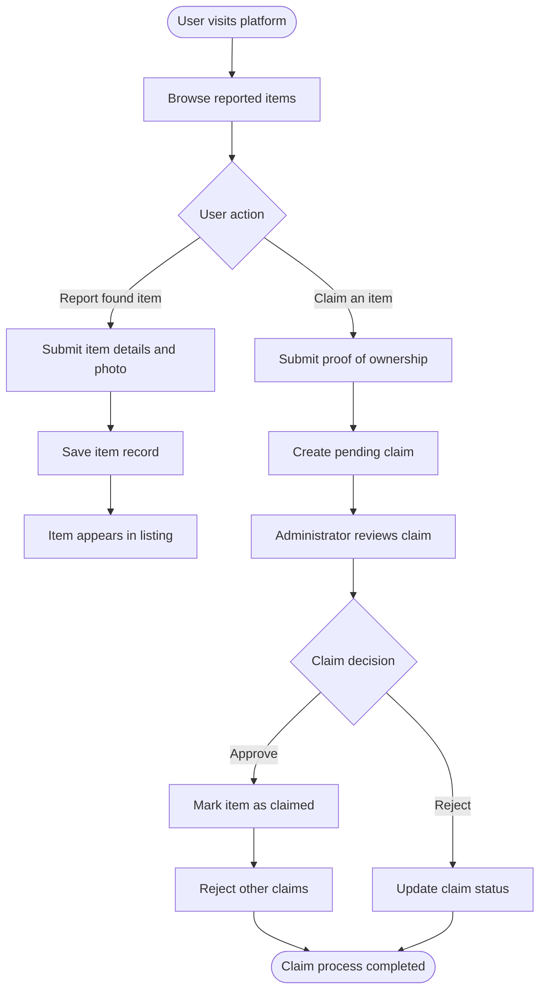
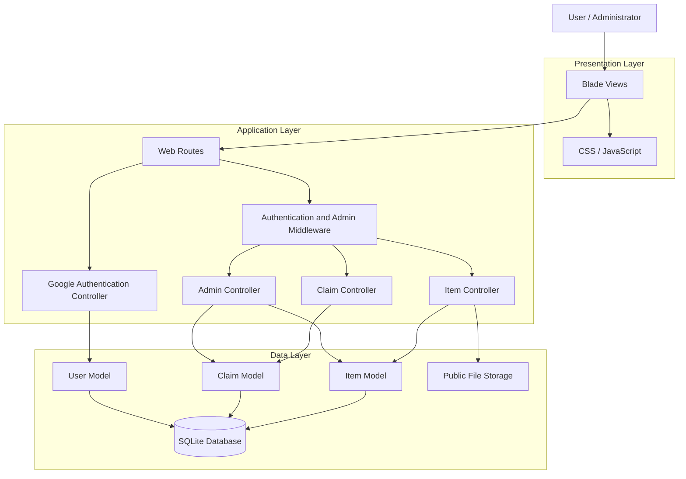
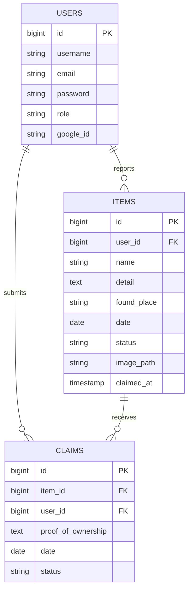

<div align="center">

# University Lost & Found

### A Centralized Lost and Found Management System for University Campuses

A web-based platform that helps students report found belongings, search for missing items, and submit ownership claims. Administrators can review claims and manage reported items through a dedicated dashboard.


</div>

---

## Overview

University Lost & Found is a centralized web application designed to simplify the process of reporting and recovering lost belongings within a university campus.

Students and staff can browse reported items, submit found-item reports, and claim belongings by providing proof of ownership. Administrators manage the platform by reviewing claims, approving legitimate requests, rejecting invalid claims, and maintaining item records.

The system aims to reduce the difficulty of locating lost belongings by providing a single platform for the university community.

## Features

### User Features

- **Browse Found Items** - View items reported by other users.
- **Search Items** - Search for reported belongings by item name.
- **Report Found Items** - Submit a found-item report with a photo, item name, location, date, and description.
- **Submit Ownership Claims** - Provide a description or proof to support an ownership claim.
- **Track Claims** - View submitted claims and their current statuses.
- **Google Authentication** - Sign in using a Google account.
- **Profile Management** - Update account information and manage your profile.

### Administrator Features

- **Admin Dashboard** - View item statistics and recent pending claims.
- **Item Management** - Browse all reported items and remove item records.
- **Claim Management** - Review submitted ownership claims.
- **Ownership Verification** - Compare the original finder's description with the claimant's proof.
- **Approve Claims** - Approve a legitimate claim and mark the item as claimed.
- **Reject Claims** - Reject an invalid ownership claim.
- **Automatic Claim Resolution** - Reject other pending claims when one claim is approved.
- **Claimed Item Cleanup** - Delete items that have remained claimed for more than three days when the cleanup command is executed.

---

## System Workflow



## How It Works

### 1. Reporting a Found Item

A logged-in user can report an item by providing:

| Information | Description |
|---|---|
| Item Name | Publicly displayed name of the item |
| Photo | Image of the found item |
| Found Location | Location where the item was found |
| Date Found | Date the item was discovered |
| Description | Additional details used for ownership verification |

The report is stored in the database with an initial `pending` status.

### 2. Claiming an Item

Users can submit an ownership claim for an available item.

The claimant must provide proof of ownership, such as:

- Item colour and physical appearance.
- Unique markings or identifiable features.
- Contents or other details that only the owner would know.

The system prevents users from claiming their own reported items and prevents duplicate claims by the same user.

### 3. Administrator Verification

Administrators review the claim by comparing:

- The original description submitted by the finder.
- The proof of ownership submitted by the claimant.

The administrator can approve or reject the claim.

When a claim is approved:
1. The selected claim becomes `approved`.
2. The associated item becomes `claimed`.
3. The item receives a claim timestamp.
4. Other claims for the same item are automatically rejected.

These updates are executed within a database transaction.

---

## Technology Stack

| Technology | Purpose |
|---|---|
| PHP 8.3+ | Backend programming language |
| Laravel 13 | Web application framework |
| SQLite | Default database |
| Laravel Eloquent ORM | Database operations and relationships |
| Laravel Socialite | Google OAuth authentication |
| Blade | Server-side page rendering |
| HTML5 | Web page structure |
| CSS3 | User interface styling |
| JavaScript | Frontend interactions |
| Alpine.js | Lightweight frontend interactions |
| Tailwind CSS | Frontend styling tools |
| Vite | Frontend asset compilation |
| Lucide Icons | Interface icons |

## System Architecture

The application follows the Model-View-Controller (MVC) architecture provided by Laravel.



### Main Application Components

| Component | Responsibility |
|---|---|
| `ItemController` | Item browsing, searching, reporting, and item details |
| `ClaimController` | Claim submission and user claim history |
| `AdminController` | Administrative dashboard, item management, and claim verification |
| `GoogleController` | Google OAuth authentication |
| `AdminOnly` Middleware | Restricts administrative routes to admin accounts |
| `Item` Model | Represents reported found items |
| `Claim` Model | Represents ownership claims |
| `User` Model | Represents registered users and their roles |

---

## Database Design

The system uses three main database entities.

### Entity Relationship Diagram



### Main Tables

| Table | Description |
|---|---|
| `users` | Stores user accounts, roles, and Google account identifiers |
| `items` | Stores found-item information, descriptions, photos, and statuses |
| `claims` | Stores ownership claims and their verification statuses |

### Item Statuses

| Status | Description |
|---|---|
| `pending` | Initial status when an item is reported |
| `claimed` | An administrator has approved an ownership claim |

### Claim Statuses

| Status | Description |
|---|---|
| `pending` | Waiting for administrator review |
| `approved` | Ownership claim has been approved |
| `rejected` | Ownership claim has been rejected |

---

## Project Structure

```text
university-lost-and-found/
│
├── app/
│   ├── Console/
│   │   └── Commands/
│   │       └── DeleteClaimedItems.php
│   │
│   ├── Http/
│   │   ├── Controllers/
│   │   │   ├── Auth/
│   │   │   │   └── GoogleController.php
│   │   │   ├── AdminController.php
│   │   │   ├── ClaimController.php
│   │   │   ├── ItemController.php
│   │   │   └── ProfileController.php
│   │   │
│   │   └── Middleware/
│   │       └── AdminOnly.php
│   │
│   └── Models/
│       ├── Claim.php
│       ├── Item.php
│       └── User.php
│
├── bootstrap/
├── config/
├── database/
│   ├── migrations/
│   └── seeders/
│
├── public/
├── resources/
│   ├── css/
│   ├── js/
│   └── views/
│       ├── admin/
│       ├── claims/
│       ├── components/
│       ├── items/
│       ├── layouts/
│       └── profile/
│
├── routes/
│   ├── auth.php
│   ├── console.php
│   └── web.php
│
├── storage/
├── tests/
├── composer.json
├── package.json
└── vite.config.js
```

---

## Installation and Setup

### Prerequisites

Make sure the following tools are installed:

- PHP 8.3 or later
- Composer
- Node.js and npm
- Git
- Required PHP extensions for Laravel

### 1. Clone the Repository

```bash
git clone https://github.com/Jacqueson1/university-lost-and-found.git
```

Navigate into the project directory:

```bash
cd university-lost-and-found
```

### 2. Install PHP Dependencies

```bash
composer install
```

### 3. Configure Environment Variables

Copy the example environment file:

**Windows PowerShell**

```powershell
Copy-Item .env.example .env
```

**Linux / macOS**

```bash
cp .env.example .env
```

Generate the application key:

```bash
php artisan key:generate
```

### 4. Configure the Database

The project uses SQLite by default.

Create the SQLite database file if it does not exist:

**Windows PowerShell**

```powershell
New-Item -ItemType File -Path database/database.sqlite
```

**Linux / macOS**

```bash
touch database/database.sqlite
```

Ensure your `.env` contains:

```env
DB_CONNECTION=sqlite
```

Run the database migrations:

```bash
php artisan migrate
```

### 5. Configure File Storage

Create the public storage symbolic link:

```bash
php artisan storage:link
```

This allows uploaded item photos to be accessed through the application's public storage directory.

### 6. Install Frontend Dependencies

```bash
npm install
```

Compile the frontend assets:

```bash
npm run build
```

### 7. Configure Google Authentication

Google authentication uses Laravel Socialite.

Create OAuth credentials in the [Google Cloud Console](https://console.cloud.google.com/) and configure the following values in `.env`:

```env
GOOGLE_CLIENT_ID=your-google-client-id
GOOGLE_CLIENT_SECRET=your-google-client-secret
GOOGLE_REDIRECT_URI=http://localhost:8000/auth/google/callback
```

Make sure the redirect URI matches the URI configured in your Google OAuth credentials.

### 8. Start the Development Server

Run:

```bash
php artisan serve
```

Open the application:

```text
http://127.0.0.1:8000
```

---

## Application Routes

### Public Routes

| Method | Route | Description |
|---|---|---|
| GET | `/` | Browse found items |
| GET | `/items/{item}` | View item details |
| GET | `/auth/google` | Start Google authentication |
| GET | `/auth/google/callback` | Handle Google authentication callback |

### Authenticated User Routes

| Method | Route | Description |
|---|---|---|
| GET | `/items/create` | Open found-item report form |
| POST | `/items` | Submit a found-item report |
| GET | `/my-claims` | View submitted claims |
| POST | `/items/{item}/claim` | Submit an ownership claim |
| GET | `/profile` | View profile settings |
| PATCH | `/profile` | Update profile |
| DELETE | `/profile` | Delete account |

### Administrator Routes

All administrator routes require authentication and the `admin` middleware.

| Method | Route | Description |
|---|---|---|
| GET | `/admin` | Administrator dashboard |
| GET | `/admin/items` | Manage reported items |
| DELETE | `/admin/items/{item}` | Delete an item |
| GET | `/admin/claims` | View submitted claims |
| GET | `/admin/claims/{claim}` | Review a claim |
| POST | `/admin/claims/{claim}/approve` | Approve a claim |
| POST | `/admin/claims/{claim}/reject` | Reject a claim |

---

## Maintenance

### Delete Old Claimed Items

The project includes an Artisan command that removes items claimed more than three days ago.

Run the command manually:

```bash
php artisan items:delete-claimed
```

The command also removes the associated image and claim records.

The command is available for maintenance, but it must be scheduled or executed manually to run automatically.

---

## Current Scope and Limitations

The current implementation focuses on the core lost-and-found workflow.

Known limitations include:

- Item searches currently match item names only.
- Ownership verification relies on administrator review.
- The system does not include automated item-matching functionality.
- Claimed-item cleanup requires the maintenance command to be executed or scheduled.
- The application does not include email or push notifications for claim status updates.

## Future Improvements

Potential improvements include:

- Search by item category, location, and date.
- Email notifications when claim statuses change.
- Item category management.
- Advanced search and filtering.
- Item matching suggestions.
- Claim history and administrative activity logs.
- Automated scheduling for claimed-item cleanup.
- Dashboard analytics and reporting.

---

## Project Purpose

This project was developed to provide a centralized digital platform for managing lost and found belongings within a university environment.

By allowing users to report found items and submit ownership claims online, the system aims to make item recovery more organized and improve the management process for university administrators.

---

<div align="center">

**University Lost & Found**

A centralized platform for reporting, managing, and recovering lost belongings.

</div>
